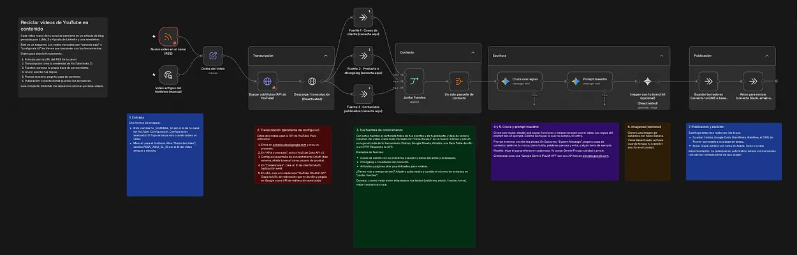

# Reciclar vídeos de YouTube en contenido que los LLMs puedan citar

Plantilla de n8n para construir una primera versión de un Content Engine: un sistema que aprovecha el conocimiento que ya generas y lo transforma en contenido para varios canales.

Por cada vídeo que publicas en YouTube, el workflow prepara:

- Un artículo de blog enriquecido con conocimiento de tu empresa, pensado para que lo encuentren Google y los LLMs.
- Tres o cuatro publicaciones de LinkedIn.
- Una edición de tu newsletter.
- Las imágenes de cada pieza siguiendo tu brand kit (opcional).

Todo queda como borrador para que lo revises, lo edites y lo apruebes.

Si llevas tiempo publicando vídeos, también puedes procesar tu histórico sin grabar nada nuevo.

Lo explico paso a paso en mi Substack: [Convertir tus vídeos de YouTube en contenido que los LLMs puedan citar](https://gerardocolindres.substack.com).

## Antes de empezar

Necesitas tres cosas:

1. Una fuente primaria de conocimiento. Aquí son tus vídeos de YouTube, aunque podrían ser webinars, podcasts, entrevistas o documentación interna.
2. Fuentes de conocimiento complementarias para enriquecer ese contenido. Una empresa de software puede tener casos de éxito, documentación de producto, un changelog y un centro de recursos. Un freelance puede tener proyectos documentados, metodologías propias y artículos publicados.
3. Una cuenta de n8n, en la nube o instalado en tu servidor.

La segunda es la que más tiempo te va a llevar. Gran parte de ese conocimiento ya existe: hay que organizarlo para que el sistema sepa cuándo y cómo usarlo.

Para las credenciales necesitarás un proyecto en Google Cloud con YouTube Data API v3 activada y una API key de Gemini ([aistudio.google.com](https://aistudio.google.com)). Puedes cambiar Gemini por otro modelo.

## Instalación

1. Descarga [`workflow.json`](workflow.json).
2. En n8n, crea un workflow nuevo, abre el menú de tres puntos y elige Import from File.
3. Sigue las notas de colores del lienzo. Cada una explica qué tienes que conectar en ese tramo.

## Cómo está montado

El workflow tiene dos puntos de entrada: se ejecuta solo cuando publicas un vídeo nuevo (a través del RSS de tu canal) o a mano cuando quieres recuperar uno antiguo.

| Paso del artículo | Nodos en el lienzo | Qué tienes que hacer |
|---|---|---|
| Entrada | Nuevo vídeo en el canal (RSS), Vídeo antiguo del histórico (manual), Datos del vídeo | Poner el ID de tu canal |
| 1. Extraer la transcripción | Grupo Transcripción | Crear la credencial de YouTube |
| 2. Cruzar con tus casos de cliente | Fuente 1 | Conectar tu base de casos |
| 3. Cruzar con tu producto | Fuente 2 | Conectar tu changelog, servicios o metodologías |
| 4. Aprovechar tu centro de recursos | Fuente 3, grupo Contexto, Cruce con reglas | Conectar tu contenido publicado y escribir tus reglas |
| 5. Generar las piezas | Prompt maestro | Pegar tu capa de contexto editorial |
| 6. Generar las imágenes (opcional) | Imagen con tu brand kit | Escribir tu brand kit y activar el nodo |
| 7. Preparar la distribución | Grupo Publicación | Conectar dónde guardas los borradores y cómo te avisa |

### Entrada

En el nodo "Nuevo vídeo en el canal (RSS)", cambia `TU_CHANNEL_ID` por el ID de tu canal. Lo encuentras en YouTube, en Configuración, Configuración avanzada.

Para un vídeo antiguo, abre "Datos del vídeo", cambia `PEGA_AQUI_EL_ID` por el ID del vídeo y ejecuta el disparador manual.

### 1. Extraer la transcripción

→ Entra: URL del vídeo.
→ Sale: transcripción.

Los dos nodos usan la API de YouTube y vienen pendientes de configurar:

1. Entra en [console.cloud.google.com](https://console.cloud.google.com) y crea un proyecto.
2. En APIs y servicios, activa YouTube Data API v3.
3. Configura la pantalla de consentimiento OAuth: tipo externo, y añade tu email como usuario de prueba.
4. En Credenciales, crea un ID de cliente OAuth de tipo aplicación web.
5. En n8n, crea una credencial "YouTube OAuth2 API". Copia la URL de redirección que te muestra n8n y pégala en Google como URI de redirección autorizado.
6. Pega en n8n el Client ID y el Client Secret, conecta tu cuenta y selecciona la credencial en los dos nodos.

La API solo deja descargar los subtítulos de vídeos de tu propio canal, y solo si existen. Si no puedes usarla, sustituye los dos nodos por un "Edit Fields" con un campo `transcripcion` donde pegues el texto a mano.

### 2, 3 y 4. Tus fuentes de conocimiento

Aquí está lo que un LLM no puede aportar por sí solo: tus datos, tus ejemplos y las experiencias reales de tus clientes.

Los tres nodos marcados con "conecta aquí" son huecos. Borra cada uno y pon en su lugar el nodo de tu herramienta: Notion, Google Sheets, Airtable, una Data Table de n8n o un HTTP Request a tu API.

| Fuente | Propiedades útiles | Para qué sirve |
|---|---|---|
| Casos de cliente | Contexto del cliente, problema, solución, resultados, aprendizajes | Añadir una historia real a una explicación teórica |
| Producto o servicios | Funcionalidad, problema que resuelve, fecha de lanzamiento | Conectar el contenido educativo con tu producto sin convertirlo en una pieza comercial |
| Contenido publicado | Título, URL, tema, si es página pilar | Trabajar el enlazado interno y ayudar al lector a profundizar |

Las tres fuentes se consultan en paralelo y se juntan en un único paquete de contexto. Si tienes más o menos de tres, añade o quita nodos y cambia el número de entradas en "Juntar fuentes".

Si eres freelance, cambia el changelog por una base de datos con tus servicios, metodologías o proyectos anteriores.

#### Las reglas

El nodo "Cruce con reglas" decide qué información entra en cada pieza. Vienen unas reglas de ejemplo; sustitúyelas por las tuyas:

- Un caso de cliente debe estar relacionado con el problema principal del vídeo.
- Una funcionalidad debe aportar una solución relevante al problema.
- Un enlace interno debe ampliar la información.
- Cualquier dato utilizado debe estar respaldado por su fuente original.

Si ninguna fuente cumple los requisitos, se queda fuera. Cuanto mejor trabajadas estén las propiedades de tus bases de datos, mejor decide el cruce.

### 5. Generar las piezas

El "Prompt maestro" recibe la transcripción y el paquete de contexto, y escribe el artículo, los posts de LinkedIn y la newsletter.

En Opciones, System Message, pega tu capa de contexto editorial:

- Quiénes sois.
- A quién os dirigís.
- Cómo escribís.
- Qué queréis transmitir.
- Qué características debe tener el contenido de cada canal.

Cada pieza tiene que tener sentido por sí sola. Un vídeo de 20 minutos puede dar cuatro ideas para cuatro posts de LinkedIn; la newsletter puede profundizar en una de ellas y el artículo desarrollar el tema completo con las fuentes anteriores.

### 6. Generar las imágenes (opcional)

El nodo viene desactivado. Usa Nano Banana a través de Gemini. Para activarlo, escribe en el prompt tu brand kit: colores, tipografía, referencias visuales y lo que nunca debe aparecer. Si generas portadas, diagramas o infografías, puedes darle instrucciones distintas para cada tipo.

### 7. Preparar la distribución

Sustituye los dos nodos finales por tu infraestructura de marketing. Un ejemplo sencillo:

- Guardar los artículos en una base de datos de Notion conectada al CMS de Framer.
- Guardar las publicaciones de LinkedIn en tu calendario editorial.
- Preparar el borrador de la newsletter.
- Avisar por Slack y crear una tarea en Asana para revisar y aprobar.

Mantén una revisión humana antes de distribuir nada. Un bloque semanal para revisar los borradores, añadir tus matices y preparar las publicaciones de los próximos días es suficiente.

## Cómo evitar que se convierta en una fábrica de AI slop

El workflow es la parte fácil de copiar. Si dedicas diez horas a montarlo, dedica unas siete a las fuentes de conocimiento, las reglas y la capa de contexto. Es lo que nadie más tiene: tus conversaciones con clientes, los aprendizajes de tus proyectos, tus datos y tu forma de interpretarlos.

La calidad del resultado depende de la calidad del conocimiento con el que lo alimentes.

## Por dónde empezar

Empieza con algo pequeño: una fuente de conocimiento, tres canales de distribución y una revisión semanal. Cuando eso funcione, añade más fuentes (transcripciones de reuniones comerciales, entrevistas con clientes, feedback de usuarios, investigaciones de mercado) o una capa de análisis que te diga qué contenidos funcionan mejor.

## Preguntas frecuentes

¿Puedo usar otro modelo en lugar de Gemini?
Sí. Cambia los nodos de Gemini por los de OpenAI, Anthropic o el proveedor que uses. Los prompts funcionan igual.

¿Funciona con vídeos de otros canales?
La API oficial de YouTube no lo permite. Puedes pegar la transcripción a mano o usar otro servicio de transcripción.

¿Puedo hacerlo con otra herramienta?
Sí. La lógica es la misma en Gumloop, Zapier o Claude Code. Este repo trae la versión de n8n.

¿Necesito saber programar?
No. Tienes que saber moverte por n8n: importar un workflow, crear credenciales y cambiar nodos.

## English summary

An n8n template for a first version of a Content Engine. Each YouTube video becomes a blog post enriched with your own knowledge sources (customer cases, product changelog, published content), 3-4 LinkedIn posts and a newsletter issue, all saved as drafts for human review. Import `workflow.json` and follow the sticky notes on the canvas (in Spanish) to connect your YouTube API credential, your knowledge sources, your rules, your editorial context and your CMS.

## Licencia

MIT. Úsalo, adáptalo a tu negocio y compártelo. Ver [LICENSE](LICENSE).

Hecho por [Gerardo Colindres](https://gerardocolindres.substack.com) · Archivo.md
